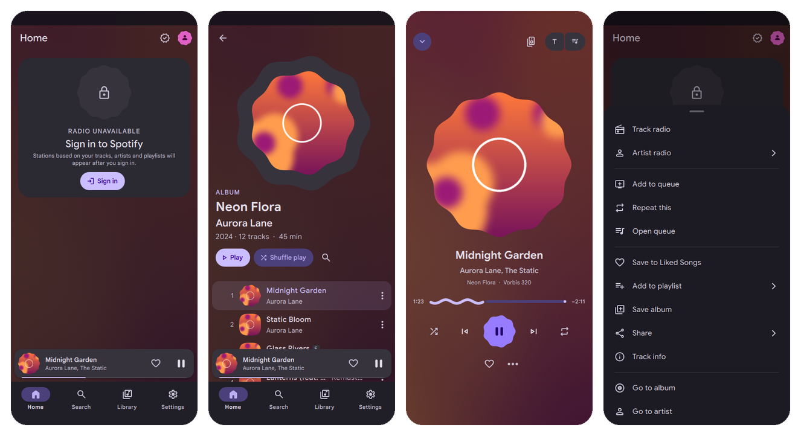

<p align="center"><b>Português</b> · <a href="README.md">English</a> · <a href="README.ru.md">Русский</a></p>

<div align="center">

<picture>
  <source media="(prefers-color-scheme: dark)" srcset="docs/brand/wordmark-on-dark.svg">
  
</picture>

[](https://github.com/makdren/materialfy/actions/workflows/release.yml)
[](https://github.com/makdren/materialfy/releases/latest)
[](https://github.com/makdren/materialfy/actions/workflows/build.yml)

Cliente do Spotify para Android feito com Rust e Qt Quick, com interface Material 3 Expressive.<br>
Um port do Materialfy desktop para o celular.

[Download](#download) ·
[Android](#android) ·
[Capturas de tela](#capturas-de-tela) ·
[Recursos](#recursos) ·
[Limitações](#o-que-falta-e-por-quê) ·
[Instalação](#instalação) ·
[Compilação](#compilando-a-partir-do-código-fonte) ·
[Dados e privacidade](#onde-os-dados-ficam-guardados)

</div>

<br>

O Materialfy substitui o app desktop oficial do Spotify para ouvir música em uma janela nativa comum. A
interface é escrita em QML (Qt 6.12), sem engine de navegador, e a lógica fica em Rust. O áudio é reproduzido
pelo [librespot](https://github.com/librespot-org/librespot) dentro do próprio processo do app, então tocar
música no computador exige Spotify Premium. As cores da interface seguem a capa da faixa atual. A interface
segue o idioma do sistema: russo em um sistema em russo, inglês nos demais casos; em Configurações → Idioma
dá para fixar qualquer um dos dois.

O projeto é montado a partir de dois projetos com licença MIT: a parte do Spotify vem do
[spotifast](https://github.com/crmne/spotifast) (crmne), a interface vem do
[yamusic-md3](https://github.com/yaskorinov/yamusic-md3) (yaskorinov). Veja
[Origem e licença](#origem-e-licença) para os detalhes.

> [!NOTE]
> Este é um fork do [fatyzzz/materialfy](https://github.com/fatyzzz/materialfy) com uma versão para Android: o
> mesmo app com layout de celular, reprodução em segundo plano, o player na "ilha" do sistema e atualização do
> APK pelo próprio app. Aqui só o APK é publicado; os builds para Windows, Linux e macOS estão nas
> [releases do original](https://github.com/fatyzzz/materialfy/releases).

## Download

O APK está na [última release](https://github.com/makdren/materialfy/releases/latest) (todas as versões estão na [página de Releases](https://github.com/makdren/materialfy/releases)):

| Sistema | Arquivo |
| --- | --- |
| Android 9+, arm64 | `Materialfy-<version>-arm64-v8a.apk` |

O `SHA256SUMS.txt` da mesma release lista o checksum. O app verifica sozinho se há novas versões nas releases
(Configurações → Atualizações): o novo APK é baixado, conferido com o checksum e entregue ao instalador do sistema.
Os builds desktop e suas atualizações estão em [fatyzzz/materialfy](https://github.com/fatyzzz/materialfy/releases).

## Android

<p align="center"></p>
<p align="center"><sub>Início, álbum, Tocando agora e o menu da faixa. Capturado com dados de teste em uma janela de 412×915.</sub></p>

O celular tem os mesmos recursos do desktop, em um layout para uma mão: navegação inferior, mini player acima
dela, player em tela cheia (deslize para baixo para fechar), menus em bottom sheets, toque longo no lugar do
clique direito e o botão Voltar do sistema.

- A música continua tocando em segundo plano: notificação de mídia com capa e busca, tela de bloqueio, botões
  do fone e do Bluetooth, pausa em ligações e ao desconectar o fone.
- O player na "ilha" do sistema: no Android 16 como Live Update (chip na barra de status, Samsung Now Bar,
  HyperOS Super Island, ColorOS Fluid Cloud), na vivo na Atomic Island do OriginOS. Dá para desligar em
  Configurações → Reprodução.
- O celular aparece no Spotify Connect como smartphone, então a música passa entre ele e o computador.
- O status "Ouvindo Spotify" no Discord vem da conexão Spotify ↔ Discord e funciona igual no celular.
- Atualizações: Configurações → Atualizações baixa o APK da release mais recente e instala por cima.

**Instalação.** Baixe `Materialfy-<version>-arm64-v8a.apk` da [última release](https://github.com/makdren/materialfy/releases/latest)
e abra o arquivo. O Android pede uma vez para permitir instalações pelo navegador ou gerenciador de arquivos. Se
houver um build de teste assinado com outra chave (`-debugsigned.apk`), desinstale-o antes: o APK da release não
é instalado por cima dele. O login funciona como no desktop: o navegador abre e, depois de entrar, você volta ao app.

É preciso um celular arm64 com Android 9 ou posterior, e Spotify Premium para o áudio. A versão Android ainda é
experimental: relate problemas em [Issues](https://github.com/makdren/materialfy/issues), de preferência com o
modelo do celular e a versão do Android.

## Capturas de tela

Feitas com uma conta Premium e música tocando; as cores seguem a capa da faixa atual.

<table>
  <tr>
    <td width="50%"></td>
    <td width="50%"></td>
  </tr>
  <tr>
    <td></td>
    <td></td>
  </tr>
  <tr>
    <td></td>
    <td></td>
  </tr>
  <tr>
    <td></td>
    <td></td>
  </tr>
  <tr>
    <td></td>
    <td></td>
  </tr>
  <tr>
    <td valign="top"></td>
    <td valign="top"><sub>O mini player: a janela muda para ele quando fica mais estreita que 480 ou mais baixa que
      400 pixels.</sub></td>
  </tr>
</table>

## Recursos

- Login pelo navegador com OAuth PKCE. Você digita a senha no site do Spotify; o app só recebe um código de
  uso único em `127.0.0.1`.
- Reprodução neste computador pelo librespot (exige Premium): 96, 160 ou 320 kbit/s, normalização de volume,
  reprodução sem pausas (gapless), crossfade de até 12 segundos, velocidade de 0,5× a 2× sem alterar o tom,
  músicas parecidas quando um álbum ou playlist termina, seleção do dispositivo de saída e cache de áudio de
  256 MB a 10 GB.
- O computador aparece no Spotify Connect com o nome definido em Configurações. Dá para passar a reprodução
  para um celular ou uma caixa de som e voltar; enquanto a música toca em outro dispositivo, a janela funciona
  como controle remoto, com o volume desse dispositivo. Caixas de som da rede local que ainda não têm login
  são encontradas por mDNS e podem ser conectadas pelo menu de dispositivos.
- Fila: uma fila manual mantida separada do contexto, "Tocar a seguir", arrastar faixas para a fila e
  reordenar linhas, remoção com desfazer.
- Rádio a partir de uma faixa, artista, álbum ou playlist, e de qualquer faixa nos resultados da busca. Uma
  estação pode ser gerada de novo ou salva como playlist.
- Biblioteca: playlists com pastas, fixação no topo (somente neste app), Músicas Curtidas, álbuns, artistas,
  podcasts. Visualização em grade ou lista, ordenação.
- Edição das suas próprias playlists: nome, descrição, capa, pública ou privada, reordenação de faixas com o
  mouse, remoção com botão Desfazer, adição de faixas a partir de recentes, curtidas e busca, criação e
  exclusão de playlists.
- Busca em faixas, álbuns, artistas, playlists e podcasts. Um link `open.spotify.com` pode ser colado ou
  solto na janela.
- Página do artista com ouvintes mensais, biografia, faixas populares e lançamentos. A página Novos
  lançamentos reúne os lançamentos recentes dos artistas que você segue.
- Podcasts: páginas de programas e episódios, progresso de escuta, capítulos, voltar 10 segundos e avançar 30.
- Letras sincronizadas. O app busca as letras primeiro no Spotify e recorre ao LRCLIB, NetEase e Musixmatch.
  A exibição é ajustável: estilo clássico, simples ou karaokê, tamanho do texto, alinhamento e espaçamento
  das linhas, o quanto as linhas que não estão sendo cantadas ficam visíveis, desfoque ligado ou desligado,
  animação de rolagem e o rótulo da fonte.
- Esquema de cores Material You a partir da capa da faixa atual ou de uma cor de destaque escolhida, temas
  claro e escuro. As animações podem ser encurtadas ou seguir a configuração do sistema.
- Três layouts de janela: completo, compacto para janela estreita, e um mini player com a opção "Sempre no
  topo" (indisponível no Wayland).
- Moldura de janela própria em todos os sistemas: botões de minimizar, maximizar e fechar do Material 3, cantos
  arredondados (no Windows 11 desenhados pelo sistema; o Windows 10 mantém cantos retos), cantos retos quando
  maximizada.
- Teclas de mídia, o tile SMTC no Windows e MPRIS no Linux, ícone na bandeja com minimizar ao fechar,
  instância única em execução.
- Interface em inglês, russo ou português (Brasil). Por padrão segue o idioma do sistema; Configurações → Idioma troca.
- Proxy: do sistema, HTTP ou SOCKS5, com usuário e senha. Login, Web API, reprodução, letras e imagens passam
  todos por ele.

## O que falta e por quê

- O librespot só funciona com contas Premium. Com uma conta gratuita a música não toca no computador, e o
  rádio, que é montado pelo librespot, fica bloqueado. A Web API do Spotify também só permite controlar outros
  dispositivos com Premium. Sem ele, ainda há biblioteca, busca e edição de playlists.
- O Spotify entrega ao librespot Ogg Vorbis de até 320 kbit/s, então não há lossless.
- Crossfade e velocidade só funcionam ao tocar neste computador. Eles não são repassados a uma caixa de som ou
  celular pelo Connect, e os outros dispositivos Spotify veem a posição da faixa com correções uma vez por
  segundo.
- Não é possível baixar faixas para ouvir offline; o app não contorna DRM. O cache de áudio só acelera a
  reprodução repetida.
- O Client ID compartilhado da Web API é um só para todos os usuários do app, e o Spotify costuma aplicar rate
  limit nele. Por isso o app usa primeiro a sua sessão do Spotify e mantém a Web API como alternativa. Os
  detalhes e como configurar o seu próprio Client ID estão em [Sessão do Spotify e Web API](#sessão-do-spotify-e-web-api).
- Alguns limites vêm da própria Web API. A fila de contexto mostra cerca de 20 faixas seguintes, porque a API
  não retorna o total. Remover uma faixa de uma playlist remove todas as suas duplicatas, porque o método de
  exclusão não aceita uma posição. O histórico do Spotify é limitado às últimas 50 reproduções.
- O app não é oficial. O Spotify pode restringir clientes de terceiros, e você é responsável pelo uso da sua
  conta.

## Requisitos

- Uma conta Spotify. Premium é necessário para áudio neste computador e para o rádio.
- Windows 10 1809 ou posterior (x64); Linux x86_64 ou aarch64; macOS 13 ou posterior (o build é experimental;
  as teclas de mídia no macOS não foram testadas); Android 9 ou posterior (arm64).
- Portas locais 8989 e 8898 livres: o Spotify redireciona o navegador de volta para elas depois do login. Se o
  firewall perguntar, permita conexões em `127.0.0.1`.

## Instalação

O jeito mais rápido é um build pronto em [Download](#download). Para compilar a partir do código-fonte:

### Windows

Você precisa de Rust, Qt 6.12 e Build Tools for Visual Studio (detalhes em [Compilação](#windows-1)). O script
gera o app e o instalador:

```powershell
git clone https://github.com/makdren/materialfy
cd materialfy
.\build_windows.ps1 -QtDir C:\Qt\6.12.0\msvc2022_64
```

Em `target\dist\` ficarão `Materialfy-<version>-Setup.exe` e uma pasta portable `materialfy\`. O instalador
não precisa de direitos de administrador e instala em `%LocalAppData%\Programs\Materialfy`.

### Linux

```bash
git clone https://github.com/makdren/materialfy
cd materialfy
./install.sh
```

O script funciona com apt, pacman, dnf e zypper. Primeiro ele mostra quais pacotes do sistema vai instalar com
sudo e espera confirmação. O Rust é instalado com rustup em `~/.cargo`. Se o sistema não tiver o Qt 6.12 com
módulos QML, o script baixa um ao lado do código-fonte, cerca de 250 MB. O primeiro build leva de 5 a 15
minutos; depois disso você tem o comando `~/.local/bin/materialfy` e uma entrada no menu de aplicativos.
Rodar o script de novo atualiza o app.

```bash
./install.sh --uninstall   # remove o comando e a entrada do menu; configurações, dados e login são mantidos
```

### macOS

Não há instalador; compile o `.app` como descrito em [Compilação](#macos-experimental).

### Android

O APK da release está descrito em [Android](#android); a compilação do APK a partir do código-fonte
está em [Compilação](#android-experimental).

## Primeira execução

O Spotify concede duas permissões separadas, e o app pede uma de cada vez.

1. Login na conta: Conta → Entrar com o Spotify. Um navegador abre e, depois que você confirma, o Spotify o
   redireciona de volta para `http://127.0.0.1:8989/login`. Isso basta para biblioteca, busca e playlists.
2. Reprodução neste computador: a tela Reprodução ou o menu de dispositivos. A segunda confirmação no
   navegador volta para `http://127.0.0.1:8898/login`. Depois disso o computador aparece no Spotify Connect.

Sem a segunda etapa, o Materialfy funciona como controle remoto de outros dispositivos (com Premium).

## Sessão do Spotify e Web API

O app tem duas formas de obter dados do Spotify.

- A sessão do librespot. É o mesmo protocolo que o app oficial usa; fica disponível depois da segunda etapa do
  login (reprodução neste computador). A sessão roda na sua conta, e as cotas da Web API não se aplicam a ela.
- A Web API (`api.spotify.com`) por meio de um Client ID. Por padrão é o Client ID compartilhado do app, um só
  para todos os usuários. O Spotify costuma responder a ele com 429 ("too many requests") e às vezes com
  `QUOTA_EXCEEDED`, caso em que a Web API não responde de jeito nenhum até a cota ser renovada, o que pode
  levar até um dia.

As leituras passam primeiro pela sessão; a Web API só é consultada quando não há sessão, quando ela não
respondeu a tempo ou quando não suporta aquela requisição. Atualmente a sessão atende playlists (a lista, o
conteúdo, edição de faixas), Músicas Curtidas, álbuns e artistas salvos, páginas de álbum, artista e faixa,
busca e Novos lançamentos. Continuam só na Web API: podcasts na biblioteca e suas páginas, histórico de
reprodução, as prateleiras da página inicial "Top" e "Feito para você", rótulos de semente do rádio, criar uma
playlist, alterar o nome ou a capa dela, seguir a playlist de outra pessoa e controle remoto de outro
dispositivo (comandos e consulta do estado dele).

Para fazer o Client ID compartilhado durar mais, o cliente da Web API:

- divide as requisições em três filas: a página que você abriu, atualização em segundo plano e consulta do
  estado do player. O segundo plano recebe até dois terços do orçamento (a chave compartilhada permite 40
  requisições a cada 30 segundos), a consulta um quarto, as páginas todo o orçamento;
- junta requisições idênticas já em andamento e guarda respostas GET por 20 segundos (qualquer escrita limpa
  o cache e impede que ele se encha por um minuto);
- depois de um 429 ou de uma cota esgotada, mantém o segundo plano e a consulta fora da rede, enquanto as
  páginas tentam de novo a cada 15 segundos, ou a cada minuto no caso de cota. A consulta do player espera
  mais a cada 429 consecutivo: um minuto, dois, quatro, até dez minutos.

Enquanto um limite estiver ativo, Configurações → Conta mostra um aviso "Web API limitada" com uma estimativa
de quando termina.

### Seu próprio Client ID

Se a chave compartilhada continuar batendo nos limites, registre o seu próprio app no Spotify. Os limites dele
são compartilhados só com você.

1. Abra [developer.spotify.com/dashboard](https://developer.spotify.com/dashboard), entre e clique em
   "Create app".
2. Qualquer nome e descrição servem. Adicione `http://127.0.0.1:8989/login` em Redirect URIs e marque Web API
   na seção de API. Salve.
3. Um app novo roda em modo de desenvolvimento e só deixa entrar os usuários da sua lista. Adicione o e-mail
   da sua conta Spotify em "User Management".
4. Copie o Client ID (32 caracteres) da página do app.
5. No Materialfy: Configurações → Conta → App pessoal do Spotify → Configurar. O formulário mostra o redirect
   URI do passo 2 com um botão de copiar. Cole o Client ID, clique em Salvar e confirme o acesso no navegador.

Mesmo com o seu próprio Client ID, algumas requisições da Web API passam pelo compartilhado: playlists de
outras pessoas, a lista das suas playlists, busca de playlists, e faixas populares e artistas relacionados na
página do artista.

## Onde os dados ficam guardados

| O quê | Windows | Linux | macOS |
|---|---|---|---|
| Configurações | registro `HKCU\Software\materialfy\Materialfy` | `~/.config/materialfy/Materialfy.conf` | `~/Library/Preferences/materialfy/Materialfy.conf` |
| Dados (sessão do player, histórico) | `%APPDATA%\materialfy\Materialfy` | `~/.local/share/materialfy/Materialfy` | `~/Library/Application Support/materialfy/Materialfy` |
| Cache (áudio, capas, letras) | `%LOCALAPPDATA%\materialfy\Materialfy\cache` | `~/.cache/materialfy/Materialfy` | `~/Library/Caches/materialfy/Materialfy` |
| Tokens e senha do proxy | Credential Manager | Secret Service (keyring) | Keychain |

Os segredos ficam guardados apenas no repositório do sistema, com o nome `materialfy`. Sair da conta em
Configurações remove todas as permissões do Spotify desse repositório. O cache permanece; ele pode ser limpo
em Configurações → Armazenamento.

## Privacidade

O app não tem telemetria nem estatísticas de uso próprias. As requisições de rede vão para os servidores do
Spotify (login, Web API, reprodução, capas) e para os serviços de letras LRCLIB, NetEase e Musixmatch. Na rede
local, o app procura dispositivos Spotify Connect por mDNS.

Você digita a senha do Spotify somente em `accounts.spotify.com`, no seu próprio navegador. O app pede acesso à
biblioteca, às playlists e ao controle de reprodução, e lê o seu plano (Free ou Premium) por meio de
`user-read-private`. Ele não pede acesso ao seu e-mail.

## Atalhos de teclado

| Teclas | Ação |
|---|---|
| <kbd>Space</kbd> | tocar ou pausar |
| <kbd>Ctrl</kbd> + <kbd>→</kbd> / <kbd>←</kbd>, teclas de mídia | faixa seguinte ou anterior |
| <kbd>Ctrl</kbd> + <kbd>↑</kbd> / <kbd>↓</kbd> | volume |
| <kbd>Shift</kbd> + <kbd>→</kbd> / <kbd>←</kbd> | avançar ou voltar 10 segundos |
| <kbd>Ctrl</kbd> + <kbd>P</kbd> | player em tela cheia |
| <kbd>Ctrl</kbd> + <kbd>L</kbd> | letras |
| <kbd>Ctrl</kbd> + <kbd>F</kbd> | buscar na lista; pressione de novo para a busca global |
| <kbd>Ctrl</kbd> + <kbd>Shift</kbd> + <kbd>L</kbd> | biblioteca |
| <kbd>Ctrl</kbd> + <kbd>B</kbd> | recolher ou expandir a barra lateral |
| <kbd>Ctrl</kbd> + <kbd>,</kbd> | configurações |
| <kbd>Alt</kbd> + <kbd>←</kbd>, botão voltar do mouse | voltar |
| <kbd>F11</kbd> | tela cheia |
| <kbd>Ctrl</kbd> + <kbd>Q</kbd> | sair no Linux (<kbd>⌘</kbd> + <kbd>Q</kbd> no macOS) |

## Compilando a partir do código-fonte

Requisitos comuns:

- Rust 1.98 ou posterior ([rustup](https://rustup.rs); no Windows, a toolchain `stable-x86_64-pc-windows-msvc`).
- Qt 6.12 com os módulos qtdeclarative, qtsvg, qtshadertools e qtimageformats. Pode ser instalado com o
  Qt Online Installer ou com o [`install_qt.py`](.github/scripts/install_qt.py), o script que o CI usa: ele baixa
  arquivos de download.qt.io e verifica os checksums.
- Python 3 para o `install_qt.py`.

O cxx-qt encontra o Qt pela variável `QMAKE` (o caminho do `qmake6`). O app compilado procura o QML nesta
ordem: `$MATERIALFY_QML_DIR`, depois `qml/` ao lado do executável, depois `src/materialfy/qml` no repositório,
de modo que `cargo run` funciona a partir da árvore de código-fonte.

Compile com `--locked`. O `Cargo.lock` fixa o `vergen 9.0.6`; a versão 9.1 quebra o build script do `librespot-core`.
Não rode `cargo update` sem `-p`.

### Windows

Você precisa do [Build Tools for Visual Studio 2022](https://visualstudio.microsoft.com/visual-cpp-build-tools/) com
a carga de trabalho "Desktop development with C++", Rust (msvc), Qt 6.12 `msvc2022_64`, PowerShell 7 e, para o
instalador, [Inno Setup 6](https://jrsoftware.org/isinfo.php) (`winget install JRSoftware.InnoSetup`).

```powershell
python .github\scripts\install_qt.py --out C:\Qt\6.12.0\msvc2022_64   # se o Qt ainda não estiver instalado
.\build_windows.ps1 -QtDir C:\Qt\6.12.0\msvc2022_64
```

O [`build_windows.ps1`](build_windows.ps1) executa `cargo build --locked --release -p materialfy`, monta o exe,
`qml\`, `assets\`, as bibliotecas do Qt (via windeployqt) e o runtime do MSVC em `target\dist\materialfy\`, e
depois chama o Inno Setup se o encontrar. Sem `-QtDir`, o script procura o Qt em `$env:QTDIR`, ao lado de
`$env:QMAKE`, em `C:\Qt\6.12.0\msvc2022_64` e em `~\Qt\6.12.0\msvc2022_64`.

| Flag | O que faz |
|---|---|
| `-SkipInstaller` | pula a etapa do Inno Setup |
| `-Portable` | também gera `Materialfy-<version>-windows-x64-portable.zip` |
| `-SkipBuild` | usa um `target\<profile>\materialfy.exe` existente |
| `-CargoProfile debug` | build de debug |
| `-Version 1.2.3` | versão do instalador (por padrão vem do `Cargo.toml`) |
| `-OutDir DIR` | diretório de saída (`target\dist` por padrão) |

Para desenvolver sem empacotar:

```powershell
.\run_windows.bat --new-instance      # cargo run --release com o Qt que encontrar; os argumentos vão para o app
```

ou manualmente:

```powershell
$env:QMAKE = "C:\Qt\6.12.0\msvc2022_64\bin\qmake6.exe"
$env:PATH = "C:\Qt\6.12.0\msvc2022_64\bin;$env:PATH"
cargo run --locked -p materialfy
```

### Linux

O jeito mais fácil é `./install.sh` (veja [Instalação](#linux)). Manualmente no Debian ou Ubuntu:

```bash
sudo apt install build-essential pkg-config lld python3 7zip libasound2-dev libpulse-dev \
    libgl-dev libegl-dev libxkbcommon-dev libfontconfig1-dev libdbus-1-dev libxcb-cursor0 libxkbcommon-x11-0

python3 .github/scripts/install_qt.py --out ~/Qt/6.12.0/gcc_64
export QMAKE=~/Qt/6.12.0/gcc_64/bin/qmake6 LD_LIBRARY_PATH=~/Qt/6.12.0/gcc_64/lib

cargo run --locked --release -p materialfy
```

Em versões mais antigas do Ubuntu, o pacote `7zip` se chama `p7zip-full`. No Arch:
`sudo pacman -S base-devel lld alsa-lib libpulse 7zip`. O cxx-qt não faz o link com o GNU ld.bfd; é preciso
`lld`, `mold` ou `gold`.

O AppImage e o `tar.gz` são gerados pelo [`package_linux.sh`](.github/scripts/package_linux.sh); a saída vai para
`target/dist/`:

```bash
bash .github/scripts/package_linux.sh 0.1.0
```

### macOS (experimental)

```bash
brew install sevenzip
python3 .github/scripts/install_qt.py --host mac --out ~/Qt/6.12.0/macos
export QMAKE=~/Qt/6.12.0/macos/bin/qmake6
cargo build --locked --release -p materialfy
bash .github/scripts/package_macos.sh 0.1.0   # target/dist/Materialfy.app e .dmg
```

### Android (experimental)

Precisa de Rust com o target `aarch64-linux-android`, JDK 17+, Android SDK (platform 36, build-tools 36) com NDK
r28 e duas instalações do Qt 6.12: para Android e para o host (as ferramentas dele montam o pacote).

```bash
rustup target add aarch64-linux-android
python3 .github/scripts/install_qt.py --host android --out ~/Qt/6.12.0/android_arm64_v8a
python3 .github/scripts/install_qt.py --out ~/Qt/6.12.0/gcc_64
export QT_ANDROID=~/Qt/6.12.0/android_arm64_v8a QT_HOST=~/Qt/6.12.0/gcc_64
export ANDROID_SDK_ROOT=~/Android/Sdk ANDROID_NDK_ROOT=~/Android/Sdk/ndk/28.2.13676358
android/build_apk.sh --release   # target/android/Materialfy-<version>-arm64-v8a-debugsigned.apk
```

Sem chave, o APK é assinado com a chave de debug do SDK. Para assinar com a sua, defina `ANDROID_KEYSTORE`,
`ANDROID_KEY_ALIAS` e `ANDROID_KEYSTORE_PASS`. No CI (`build.yml`, job `android`) a chave vem dos secrets
`ANDROID_KEYSTORE_BASE64` e `ANDROID_KEYSTORE_PASS`, e uma tag `v*` publica uma release com o APK (sem a
chave, a release não é criada). O Android só instala uma atualização sobre um APK assinado com a mesma chave. A parte do Android fica em
[`android/`](android) e [`crates/materialfy/cpp/mobile.cpp`](crates/materialfy/cpp/mobile.cpp); o layout de
celular em [`MobileMain.qml`](src/materialfy/qml/MobileMain.qml). No desktop, a flag `--mobile` abre o mesmo layout
em uma janela, por exemplo `--mobile --size 412x915`.

### Flags de linha de comando e variáveis

| Flag | O que faz |
|---|---|
| `--offline` | não restaura o login a partir do repositório de segredos |
| `--new-instance` | inicia uma segunda instância mesmo que o app já esteja aberto |
| `--light` | tema claro |
| `--size 1280x800` | tamanho da janela |
| `--screenshot shot.png`, `--delay 1500` | salva uma captura de tela da janela após o número de milissegundos informado e encerra |
| `--config-dir DIR` | diretório de configurações separado |
| `--set key=value` | propriedade inicial da janela, por exemplo `--set startPage=settings` |
| `--gallery` | galeria de componentes do Material 3 |
| `--mobile` | layout de celular (como no Android) |

Variáveis de ambiente: `MATERIALFY_QML_DIR` define um diretório QML personalizado, `MATERIALFY_SESSION_FILE`
define o arquivo de sessão do player, `RUST_LOG` controla o logging (por exemplo
`RUST_LOG=materialfy=debug,sf_player=debug`).

### Testes e CI

```bash
cargo test --locked --workspace
```

O [`build.yml`](.github/workflows/build.yml) roda em pushes e pull requests para `main` e manualmente. Neste fork
ele compila só o APK; os jobs de Windows, Linux e macOS são pulados, a menos que a variável do repositório
`DESKTOP_BUILDS` seja `true`.

## Como funciona

A interface é escrita em QML; os componentes Material 3 Expressive ficam em `src/materialfy/qml/Md3`. O núcleo
em Rust é conectado ao QML por meio do [cxx-qt](https://github.com/KDAB/cxx-qt). O código assíncrono roda em um
único runtime tokio, e a thread de UI do Qt recebe snapshots de estado já prontos.

| Crate | O que faz |
|---|---|
| `md3-model` | tipos de dados para o QML: faixas, álbuns, playlists, dispositivos |
| `sf-auth` | login OAuth PKCE, armazenamento das permissões no repositório de segredos do sistema, proxy |
| `sf-api` | cliente da Web API do Spotify: filas com prioridade, junção e cache de GET, cooldown após 429 e erros de cota |
| `sf-player` | librespot e Spotify Connect, fila, conciliação da reprodução local e remota |
| `sf-services` | login, biblioteca, catálogo, rádio, início, letras, dispositivos, histórico |
| `mf-theme` | esquemas Material You a partir de uma capa ou de uma cor escolhida |
| `mf-lyrics` | letras de várias fontes, parsing de LRC, cache |
| `mf-platform` | diretórios, configurações, MPRIS, instância única |
| `mf-i18n` | tradução da interface: strings em inglês no código, dicionários em russo e português de `i18n/ru/*.json` e `i18n/pt/*.json` |
| `materialfy` | o executável: pontes QML, flags de linha de comando, cache de imagens, moldura de janela no Windows |

## Origem e licença

Este repositório é um fork do [fatyzzz/materialfy](https://github.com/fatyzzz/materialfy) que adiciona a versão
para Android (`android/`, `MobileMain.qml`, `crates/materialfy/cpp/mobile.cpp`). A licença é a mesma.

O Materialfy é baseado em dois projetos com licença MIT:

- [spotifast](https://github.com/crmne/spotifast) (Carmine Paolino, crmne): login, cliente da Web API,
  reprodução pelo librespot, Spotify Connect, fila, biblioteca e rádio (`crates/sf-*`).
- [yamusic-md3](https://github.com/yaskorinov/yamusic-md3) (yaskorinov e colaboradores): a interface QML e
  a biblioteca de componentes Material 3 Expressive, o shell cxx-qt, tema a partir da capa, letras, serviços de
  plataforma, scripts de build (`src/materialfy/qml`, `crates/materialfy`, `crates/mf-*`).

Componentes de terceiros: [librespot](https://github.com/librespot-org/librespot) (MIT, nosso próprio fork
[fatyzzz/librespot](https://github.com/fatyzzz/librespot) com os patches do crmne),
[fastframe](https://github.com/dennisgr7/fastframe) (MIT, saída de áudio e teclas de mídia),
[cxx-qt](https://github.com/KDAB/cxx-qt) (MIT ou Apache-2.0), [Qt 6](https://www.qt.io) (LGPL-3.0, vinculado
dinamicamente), a fonte Google Sans (SIL Open Font License 1.1) e os ícones Material Symbols Rounded (Apache License
2.0).

O Materialfy é licenciado sob a GNU General Public License, versão 3 ou qualquer versão posterior
(GPL-3.0-or-later); o texto está em [LICENSE](LICENSE). As releases até a 0.2.1, inclusive, foram publicadas sob a
MIT License, e o código tirado do spotifast e do yamusic-md3 mantém o aviso MIT em
[LICENSES/MIT.txt](LICENSES/MIT.txt). Autores, fontes e licenças das dependências
estão listados em [NOTICE](NOTICE). O logotipo "Wave-M" está em [`docs/brand/`](docs/brand/).

<br>

<p align="center"><sub>O Materialfy não é afiliado ao Spotify AB nem endossado por ele. Spotify é uma marca registrada do Spotify AB.</sub></p>
